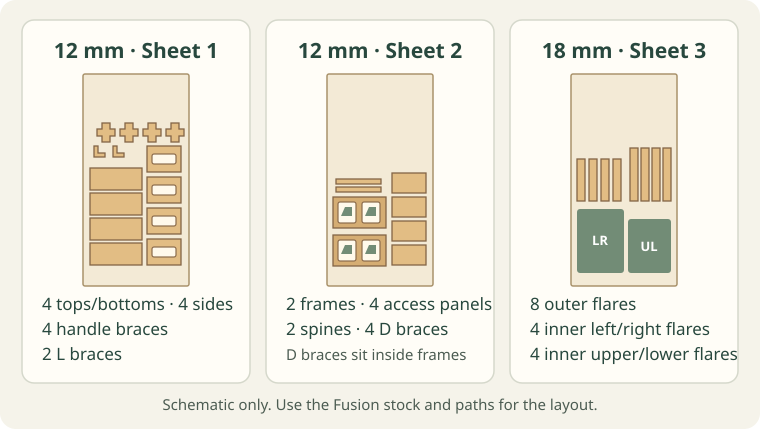

# JMOD fabrication guide

23 November 2026 · JMOD 2.0 · Planning for two cabinets in one cutting run

Start with the [build plan](SKRAM%20%2B%20JMOD%20Build%20Plan.md) for the group’s budget and equipment decisions. This guide takes the two-cabinet layout through file prep, plywood and a first test cut. The cutting run yields 42 plywood parts for two cabinets. Each cabinet also gets one printed throat adapter. Assembly and finishing are sketched at the end.

## 1. Open the plans and get oriented

1. Open `JMOD Multiple Entry Horn.pdf` in the local `JMOD 2.0 DIY Package`, or get it from JW Sound. Keep pages **9–12** open. Page 10 shows the sheet layouts and the flipped flare blocks. Page 11 shows what each numbered part looks like. Page 12 shows the cuts still to do after CNC. There were six CNC setups and 18 operations in the local Fusion archive. [JW Sound plans and package](https://www.jwsound.live/designs/jmod)
2. Open a working copy of `JMOD 2.0 Fusion.f3d` in **Autodesk Fusion**, then switch to **Manufacture**. Expand the setups and turn on just one at a time. The `.step` file is useful for viewing the shapes in another CAD program. To start from STEP, you’d have to recreate the cutter paths, including the 3D cuts on the horn panels. [Open a local Fusion archive](https://help.autodesk.com/view/fusion360/ENU/?caas=caas%2Fsfdcarticles%2Fsfdcarticles%2FHow-to-use-the-local-translation-process-to-open-files-in-Fusion-360.html)
3. Complete the **Fab CNC sign-off** with a shop lead before independent use. Use the wiki’s photos to find the Fabman terminal, alignment jig, collets and dust shoe. The wiki also lists **Woodworking 101** for the track saw, table saw, edge router and drill press, and separate printer training. [Fab CNC and reference photos](https://wiki.alt-makers.com/cnc/#mekanika-fab-cnc) · [Woodworking access](https://wiki.alt-makers.com/woodworking/) · [Printer training](https://wiki.alt-makers.com/3d-printers/)

| Where | Software | What it does |
| --- | --- | --- |
| Laptop or shared shop computer | **Autodesk Fusion → Manufacture** | Set up the sheets and cutters, check the cutter paths and run a simulation. |
| Inside Fusion | **Mekanika post-processor** | Turn the paths into `.nc` files for the controller. Use the shop’s accepted configuration. Fusion Personal Use supports 3-axis work and posts one cutter per file. Keep the files in machining order, even if that means returning to the first cutter later. |
| Fab touchscreen | **PlanetCNC TNG** | Load the `.nc` files from a USB stick, preview them and run the machine after the physical checks. It is already installed on the Fab. |
| Laptop and shop printer | **PrusaSlicer → Prusa Connect** | Prepare the two printed throat adapters and send the finished print jobs to the shop printer. |

[Alt Makers CNC software and file transfer](https://wiki.alt-makers.com/cnc/#software) · [Autodesk Mekanika post](https://cam.autodesk.com/hsmposts?p=mekanika) · [Fusion Personal Use limits](https://www.autodesk.com/support/technical/article/caas/sfdcarticles/sfdcarticles/Fusion-360-Free-License-Changes.html) · [Alt Makers PrusaSlicer instructions](https://wiki.alt-makers.com/3d-printers/#prusa-slicer)

## 2. Prepare the plywood

1. Plan for **two 12 mm sheets and one 18 mm sheet** of flat, uncoated birch plywood. Use BB/BB faces and check the ply core and bonding specification against the [wood sourcing review](Wood%20sourcing%20review.md). The STEP file has three full sheet models, each **1,219.2 × 2,438.4 mm** (4 × 8 ft). The wiki lists a **1,330 × 2,700 mm** working area on the Fab. The workshop’s listed **1,250 × 2,500 mm** birch sheets fit within that travel on paper, leaving 80 mm across and 200 mm along the bed before workholding and clearance. [Alt Makers Fab dimensions](https://wiki.alt-makers.com/cnc/#mekanika-fab-cnc)
2. For the workshop-size boards, **plan on zero saw cuts before CNC** if the actual sheets fit the jig and the revised setup clears the edges and screws. The extra width and length have to be accounted for when matching the physical sheet to the model. For oversized supplier stock, have the supplier cut it to the blank size agreed in Fusion, or use the workshop’s **Makita SP6000 track saw** on a fully supported sheet. Keep the offcuts for test pieces. The CNC cuts out the individual cabinet parts. [Alt Makers track saw](https://wiki.alt-makers.com/woodworking/track-saw/)
3. Label the sheets **12-1**, **12-2** and **18**. Mark both faces and the straight reference edge. Use callipers to measure the thickness near several corners and along the edges. Record length and width, check that the corners are square and look for bow, damaged veneers and exposed core voids. Take these measurements into Fusion. The supplied setups reference solid stock bodies, so check the stock definition and the actual cut depths as well as the sheet size.

Recent shop stock, outside-material permission and the final price are still open. Keep the 18 mm sheet full-size for the first CAM review. The shorter blank in the [earlier Possling study](Notes/JMOD%20plywood%20-%20Possling%20sheets.md) was estimated from the parts’ footprint. A shorter blank needs its own setup and clearance check before it can go on a saw order.

## 3. Check the six CNC setups

Use the table to find each setup in Fusion. The first two 12 mm jobs are candidates for the first production session after the scrap test. The 18 mm work needs both cutter types and a confirmed way to hold and locate the two blocks on their second faces.

| Setup in Fusion | What to look for in the preview |
| --- | --- |
| `12mm Sheet 1 Top` | Four top/bottom panels, four side panels, four handle braces and two L braces. Check which face carries each handle recess and which operations make the openings, pockets and outlines. |
| `Handle Recess Bottom` | The archive points to one Sheet 1 body, with one recess and one opening contour selected. Before cutting Sheet 1, map those cuts against the top setups in Fusion and verify **all four** handle recesses and openings, including face, fit and when to flip. Use a positive stop or fixture agreed with the shop lead if a loose panel needs to go back on the machine. |
| `12mm Sheet 2 Top` | Two rear frames, four access panels, two spines and four D braces. The D braces sit inside the rear-frame openings in the layout. Keep them supported while cutting. Check which holes are through-cuts and which are marks for drilling. |
| `18mm Top` | Sixteen horn panels in total. Check the flat cuts, the 3D bevel passes and the two blocks that carry the inner flares. Leave each block connected until its reverse work is complete. |
| `LR Flares Bottom` | Flip the block holding four inner left/right flares. The ball-nose cutter forms the woofer cone recesses. Check the mirrored position and retention before the cut that frees the parts. |
| `UL Flares Bottom` | Flip the separate block holding four inner upper/lower flares. The back pockets form the throat adapter’s mounting seats. Keep the extra corner shown on p. 10 as a reference until this setup is done. |

1. **Match the cutters.** The designer specifies a **¼″ (6.35 mm) compression cutter** for flat work and a **¼″ ball-nose cutter** for shaped surfaces. Match the shop collet to each tool’s actual shank. The two saved cutters both have ¼″ shanks and need a matching collet. Check cutting length, clearance through the 18 mm ply and into the spoilboard as planned, and shaft and holder clearance in the pockets. For the compression cutter, check where the two flute directions meet and test the cut in both thicknesses. The project’s listed 3 mm bit has 17 mm of cutting edge. Leave it out of the 18 mm through-cut setup. A different tool diameter needs updated CAM and a new test. [Alt Makers collets and tool setup](https://wiki.alt-makers.com/cnc/#mekanika-fab-cnc)
2. **Match the reference point.** Fusion’s saved setups use a top stock corner. The Fab wiki describes a shared XY reference with a locating jig and a tool-length probe at the bed. At sign-off, work out how the CAM zero for each face maps to the shop setup, including which surface is Z zero. Leave the shared XY setting alone. For both flare blocks, mark the face, reference edge and flip direction before releasing the block. Re-locate it against a repeatable stop or fixture and verify the mapped zero before cutting.
3. **Plan how everything stays put.** The wiki describes screwing the sheet to the spoilboard, the sacrificial board under the work. Put screws in waste areas and show their positions on the setup sketch. In Fusion, check screw, tool holder and dust-shoe clearance and that the smaller parts and loose centres stay held through their last cut. Use tabs or another shop-approved setup to keep them attached. Confirm where any original holding tabs are placed and when they can be removed.
4. **Regenerate, simulate and post.** In Manufacture, check the first and last move, pocket depths, 3D shapes, holes, cut order and clearances on each face, including during retracts. `Mark holes` has a saved depth of 2.5 mm below stock top, so budget time to drill the actual fastener holes. Use cutter-specific speed, feed and depth per pass for the birch test with the shop lead. When the regenerated paths are clean, post separate, numbered `.nc` files by setup and cutter. Write the stock label, face, zero, tool and order beside each program. [Mekanika’s Fusion simulation and posting walkthrough](https://www.mekanika.io/en/blog/cnc-milling/module-1-2-d-modeling-and-milling)

The PDF, STEP stock bodies, Fusion archive and adapter mesh were inspected. The saved setups still need regeneration in Fusion, a PlanetCNC preview and a physical cut on the shop’s machine.

## 4. Cut scrap before the first sheet

1. Bring the USB stick, setup notes, callipers, scraps of both thicknesses and one sample handle with its gasket if available. For the 18 mm test, include a representative curved cut and a small piece that can be flipped and re-located. Use a flange from the print or the relevant fitting when checking the part.
2. Follow the shop lead and [Fab operating steps](https://wiki.alt-makers.com/cnc/#mekanika-fab-cnc) at the machine. The wiki sequence starts with **Home → immediately Square**. Load the file, secure the scrap, verify the shared XY reference, then fit and measure the tool. Check in at the Fabman terminal and enable the spindle as shown at sign-off. Review the path in PlanetCNC, including travel above the stock, and do the shop’s clearance check before cutting. Re-measure tool length at each cutter change and check the new program and zero for every flip.
3. Run the dust collector and use the shop’s eye and hearing protection. Stay with the machine. Confirm the spindle is running before it enters wood. Stop if stock shifts, a tab breaks, the cutter approaches a screw, or the spindle fails to start. The wiki distinguishes **pause**, which can leave the spindle turning, from the physical emergency stop. [Alt Makers CNC safety](https://wiki.alt-makers.com/cnc/#safety)
4. Check the scrap for clean edges, the right pocket depth, full separation where intended, intact tabs and alignment after a flip. Try the handle and gasket in the test recess. Check that the curve and mounting seat match the model and the actual mating part. Once the relevant tests pass, cut the first sheet, check the first parts while they’re still easy to trace to the program, then continue through the remaining setups. Label each part with its p. 11 number, cabinet **A** or **B**, and orientation as it comes off the bed.

## 5. Print the throat adapters alongside CNC prep

Import `Throat Adapter.stl` in **PrusaSlicer** in millimetres. The mesh measures about **170 × 120 × 90 mm**, which fits within the wiki’s **250 × 220 × 270 mm** Core One volume. The designer lists plain PETG as suitable and prefers PETG-CF. Plain **Prusament PETG** on the PLA/PETG Core One is a practical starting option. The wiki marks the hardened-nozzle carbon-fibre Core One as awaiting setup, so check availability if choosing PETG-CF. [JW Sound plans, p. 9](https://www.jwsound.live/designs/jmod) · [Alt Makers PETG Core One](https://wiki.alt-makers.com/3d-printers/#prusa-core-one-plapetg) · [Alt Makers composite printer](https://wiki.alt-makers.com/3d-printers/#prusa-core-one-carbon-fibernylon)

After printer training, select the exact machine, nozzle and matching filament profile. Check support, openings and bolt holes in the sliced preview. Print one first, using the shop’s PETG plate and on-site start procedure. Once it has cooled, test it against the DCX464 and flare mounting seats before printing the second. Use the supplied throat adapter for each cabinet. The extra cone filler shown in some models was experimental. [Alt Makers slicer and Prusa Connect](https://wiki.alt-makers.com/3d-printers/#prusa-slicer) · [Designer’s cone-filler clarification](https://www.diyaudio.com/community/threads/jmod-v2-build-thread.429672/page-9)

## 6. After cutting

| Stage | What we’ll work through nearer the time |
| --- | --- |
| Bench prep | Rev. 2.03 p. 12. Cut the **22.5° bevels on both long edges** of each of the four outer left/right flares, part 5. That’s eight bevel cuts for the pair. Match the drawing and test the guarded saw setup on scrap. Use a **¼″ radius roundover** on the indicated inside edges of the woofer ports, using a router and bit with a matching shank and collet. Check and drill from the CNC marks for the actual hardware. Fit **32 M6** tee nuts to the two rear frames and **16 M5** tee nuts to the four inner left/right flares. [Table saw](https://wiki.alt-makers.com/woodworking/table-saw/) · [Edge router](https://wiki.alt-makers.com/woodworking/edge-router/) · [Drill press](https://wiki.alt-makers.com/woodworking/drill-press/) |
| Dry fit and glue | Rev. 2.03 pp. 13–17. Dry-clamp each complete kit and check the adapter-to-wood fit and woofer sealing face. Follow the designer’s glue sequence from the shell and left/right flares to the upper/lower flares and internal braces. Reserve clamp and bench space before glue-up. |
| Fill, finish and fit hardware | Smooth the horn transitions and keep the sealing faces flat. Recheck the four DCX464 mounting bolts **per adapter** shown on p. 19 against the parts list on p. 9, which lists four for the pair. Check the actual fit before buying bolts. Install handles, gaskets and fittings after the finish has cured. |
| Wire and commission | Use the [build plan](SKRAM%20%2B%20JMOD%20Build%20Plan.md) and [sound setup guide](Sound%20Setup%20Guide.md) for the planned bi-amp hardware, wiring checks and protection before powered testing. |

The plywood route, cutters and workholding, adapter material, and the number of cabinets to equip in the first stage are decisions for the build. The cabinet and horn geometry follow John White’s JMOD plans. [JW Sound](https://www.jwsound.live/designs/jmod)
