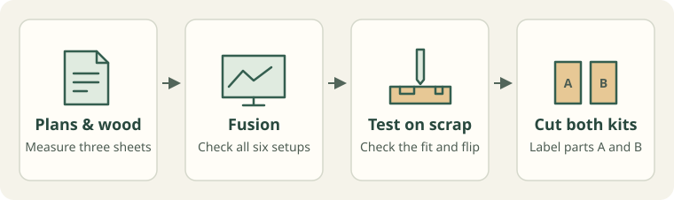
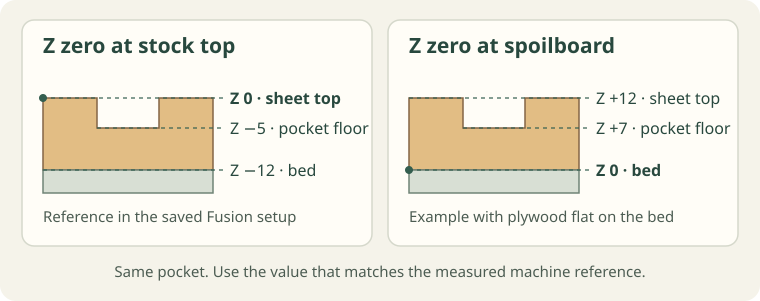
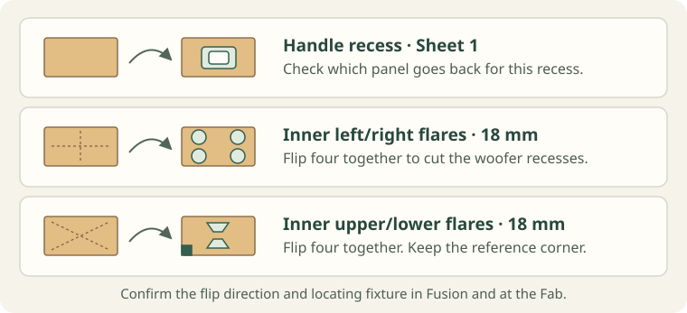

# JMOD fabrication guide

23 November 2026 · JMOD 2.0 · Planning for two cabinets in one cutting run

The cutting run covers 42 plywood parts and two printed throat adapters. Ben has completed Woodworking 101 and CNC sign-off. Start at home with the Fusion file and the checks below. On nominal stock you can audit the selections and run a first simulation. At the Fab, measure the wood and fixture, update the setup and cut scrap first.

[Set up Fusion](#3-set-up-the-job-in-fusion) · [12 mm panels](#4-cut-the-12-mm-panels) · [18 mm flares](#5-cut-the-18-mm-flares) · [Post and test](#6-simulate-post-and-prove-the-cuts) · [Build plan](SKRAM%20%2B%20JMOD%20Build%20Plan.md)



## 1. Open the plans and get oriented

1. Open `JMOD Multiple Entry Horn.pdf` in the local `JMOD 2.0 DIY Package`, or get it from JW Sound. Keep pages **9–12** open. Page 10 shows the sheet layouts and the flipped flare blocks. Page 11 shows what each numbered part looks like. Page 12 shows the cuts still to do after CNC. There were six CNC setups and 18 operations in the local Fusion archive. [JW Sound plans and package](https://www.jwsound.live/designs/jmod)
2. Download or install **Autodesk Fusion** on your laptop, or use the workshop computer. Open the `.f3d` file for this job. It has all six saved CNC setups. The `.step` file is useful for looking at the shapes and stock bodies. The opening steps in section 3 use the `.f3d`.
3. Keep the Fab wiki open for the machine’s own reference photos and controls. The printer has its own training and profile. [Fab CNC reference photos](https://wiki.alt-makers.com/cnc/#mekanika-fab-cnc) · [Printer training](https://wiki.alt-makers.com/3d-printers/)

| Where | Software | What it does |
| --- | --- | --- |
| Laptop or shared shop computer | **Autodesk Fusion → Manufacture** | Set up the sheets and cutters, check the cutter paths and run a simulation. |
| Inside Fusion | **Mekanika post-processor** | Turn the paths into `.nc` files for the controller. Use the shop’s accepted configuration. Fusion Personal Use supports 3-axis work and posts one cutter per file. Keep the files in machining order, even if that means returning to the first cutter later. |
| Fab touchscreen | **PlanetCNC TNG** | Load the `.nc` files from a USB stick, preview them and run the machine after the physical checks. It is already installed on the Fab. |
| Laptop and shop printer | **PrusaSlicer → Prusa Connect** | Prepare the two printed throat adapters and send the finished print jobs to the shop printer. |

[Alt Makers CNC software and file transfer](https://wiki.alt-makers.com/cnc/#software) · [Autodesk Mekanika post](https://cam.autodesk.com/hsmposts?p=mekanika) · [Fusion Personal Use limits](https://www.autodesk.com/support/technical/article/caas/sfdcarticles/sfdcarticles/Fusion-360-Free-License-Changes.html) · [Alt Makers PrusaSlicer instructions](https://wiki.alt-makers.com/3d-printers/#prusa-slicer)

## 2. Prepare the plywood


1. Plan for **two 12 mm sheets and one 18 mm sheet** of flat, uncoated birch plywood. Use BB/BB faces and check the ply core and bonding specification against the [wood sourcing review](Wood%20sourcing%20review.md). The STEP file has three full sheet models, each **1,219.2 × 2,438.4 mm** (4 × 8 ft). The wiki lists a **1,330 × 2,700 mm** working area on the Fab. The workshop’s listed **1,250 × 2,500 mm** birch sheets fit within that travel on paper, leaving 80 mm across and 200 mm along the bed before workholding and clearance. [Alt Makers Fab dimensions](https://wiki.alt-makers.com/cnc/#mekanika-fab-cnc)
2. For the workshop-size boards, **plan on zero saw cuts before CNC** if the actual sheets fit the jig and the revised setup clears the edges and screws. The extra width and length have to be accounted for when matching the physical sheet to the model. For oversized supplier stock, have the supplier cut it to the blank size agreed in Fusion, or use the workshop’s **Makita SP6000 track saw** on a fully supported sheet. Keep the offcuts for test pieces. The CNC cuts out the individual cabinet parts. [Alt Makers track saw](https://wiki.alt-makers.com/woodworking/track-saw/)
3. Label the sheets **12-1**, **12-2** and **18**. Mark both faces and the straight reference edge. Use callipers to measure the thickness near several corners and along the edges. Record length and width, check that the corners are square and look for bow, damaged veneers and exposed core voids. Take these measurements into Fusion. The supplied setups reference solid stock bodies, so check the stock definition and the actual cut depths as well as the sheet size.

Recent shop stock, outside-material permission and the final price are still open. Keep the 18 mm sheet full-size for the first CAM review. The shorter blank in the [earlier Possling study](Notes/JMOD%20plywood%20-%20Possling%20sheets.md) was estimated from the parts’ footprint. A shorter blank needs its own setup and clearance check before it can go on a saw order.

## 3. Set up the job in Fusion

### Open the JMOD and find Manufacture

1. Launch the **Autodesk Fusion desktop app**. If you see **Home** with **My Fusion**, **Projects** or **Samples**, click **Open** on that screen. If you already have a document open, click the **File** icon in Fusion’s top bar and choose **Open**, or press **⌘O**. In the Open window choose **Open from my computer**, then select `JMOD 2.0 DIY Package/JMOD 2.0 Fusion.f3d`. Wait for the JMOD document tab and model to appear. [Fusion Home](https://help.autodesk.com/view/fusion360/ENU/?contextId=GS-FUSION-360-APP-HOME) · [Open designs](https://help.autodesk.com/cloudhelp/ENU/Fusion-Designs/files/ASM-OPEN-FUSION-DESIGN.htm)
2. Look **at the far left of the toolbar below the document tab**, above the model. Click the workspace selector, usually labelled **DESIGN**, and choose **MANUFACTURE**. In German the same controls are **KONSTRUKTION → FERTIGEN**. Then select **Milling** (**Fräsen**) in the top row. The workspace selector appears once a design is open. [Autodesk’s desktop interface map](https://help.autodesk.com/cloudhelp/ENU/Fusion-GetStarted/files/GS-THE-FUSION-INTERFACE.htm) · [German workspace labels](https://help.autodesk.com/cloudhelp/DEU/Fusion-Configurations/files/CFG-MANUFACTURE.htm)
3. In the **Browser**, the tree on the **left of the model**, click the small triangle beside **Setups** to show the saved jobs. The toolbar **Setup** menu is where you create new setups. If the whole Browser is hidden, press **⌥⌘B**. If just its heading is visible, expand it using the arrow or plus beside **Browser**. [Manufacture Browser](https://help.autodesk.com/cloudhelp/ENU/Fusion-CAM/files/GUIDB87E0180-7CDD-41B0-866C-EEDACB946E09.htm) · [Mac shortcuts](https://help.autodesk.com/cloudhelp/ENU/Fusion-GetStarted/files/GUID-F0491540-0324-470A-B651-2238D0EFAC30.htm)

The saved tree in the designer’s archive contains these six setups. Click the triangle beside `12mm Sheet 1 Top` to see its operations.

```text
Setups
  18mm Top
  12mm Sheet 1 Top
    2D Contour10
    2D Pocket11
    2D Contour10 (2)
  12mm Sheet 2 Top
  Handle Recess Bottom
  LR Flares Bottom
  UL Flares Bottom
```

If **Manufacture** is open but the expected jobs are missing, check the file you opened. The package’s **.f3d** contains the machining setups. The **.step** contains the geometry. If **Manufacture** itself is missing from the workspace menu after the JMOD document opens, use Autodesk’s checks for that symptom before continuing. [Autodesk troubleshooting for a missing Manufacture workspace](https://www.autodesk.com/support/technical/article/caas/sfdcarticles/sfdcarticles/Manufacturing-Workspace-is-missed-in-Fusion-360.html)

### Save a working copy and check the references

1. In the Fusion **File** menu, use **Save As** to name the working design `JMOD pair – Fab prep`. If Fusion opens the **Save** dialog for the newly opened archive, give it that name on first save. In the **Browser**, right-click or Control-click `12mm Sheet 1 Top` and choose **Edit**. In the **Setup** tab look for the red X, green Y and blue Z arrows in the canvas. Screenshot the sheet, arrows and selected zero corner. Repeat for the other two top setups and the three reverse setups. [Autodesk Save As](https://help.autodesk.com/cloudhelp/ENU/Fusion-Designs/files/ASM-SAVE-AS-DESIGN.htm)
2. In **Edit Setup → Stock**, the supplied jobs use **From Solid**. Use **Inspect → Measure** to check the named stock bodies against the numbers you wrote on the sheets. Keep the nest and part bodies fixed. When using the larger workshop sheet, model the measured blank as a separate body and select it as stock in the working setup. Put any extra width or length on the far side of the two edges used to locate the sheet. Check that the selected stock corner and axes still land at the same point. For `18mm Top`, record all the stock selections before replacing any. Keep the separate `LR Flare Stock` and `UL Flare Stock` bodies for the reverse setups. [Fusion stock settings](https://help.autodesk.com/cloudhelp/ENU/Fusion-CAM/files/MFG-REF-SETUP-STOCK.htm)
3. Map Fusion’s **work zero** to the Fab’s **shared XY corner** and the actual **Z zero**. The supplied setups have zero at a top stock corner. The wiki’s tool measurement routine uses the bare bed. If the measured work Z0 is the spoilboard and the plywood sits directly on it, set the Fusion origin to the **bottom corner directly below the recorded top corner**, keeping X and Y unchanged. Where a carrier raises the wood, include its thickness in the setup. A CAD point on the carrier at the measured bed plane can serve as the origin. Check by jogging clear of the work: a tool tip at the actual sheet top should read roughly the measured sheet thickness above a bed Z0, plus the carrier height if used. Keep the shared XY setting. [Fusion setup and WCS](https://help.autodesk.com/cloudhelp/ENU/Fusion-CAM/files/GUID6614D39D-114D-424A-ABDF-F97BC6D5D88F.htm) · [Alt Makers Fab zero check](https://wiki.alt-makers.com/cnc/#mekanika-fab-cnc)
4. On the **Milling** tab in Manufacture, open **Manage → Tool Library**. The saved tools are a **6.35 mm compression cutter** and a **6.35 mm ball nose** with a 3.175 mm tip radius. Both saved tools use a ¼″ shank. Copy the tool records for the cutters you actually have and check flute length, shank and stick-out, holder size and the matching collet. The compression cutter needs enough cutting edge for the 18 mm through-cuts and a flute transition that suits both thicknesses. Use the speeds, feeds and depths for the actual cutter and birch, then prove them on scrap. A 3 mm cutter with 17 mm flutes falls short of an 18 mm through-cut. A diameter change also means regenerating and rechecking the toolpaths. [Fusion Tool Library](https://help.autodesk.com/cloudhelp/ENU/Fusion-CAM/files/MFG-TOOL-LIBRARY-OVERVIEW.htm)
5. Right-click each operation and choose **Edit**. Walk through **Tool → Geometry → Heights → Passes → Linking**. In **Geometry**, click the existing selections and see which edges or faces light up. In **Heights**, read the ring or plane for **Bottom Height** and see what it references. A shallow pocket follows a design face. A through-cut has to reach the underside of the measured sheet with the intended spoilboard allowance. Record the thickness left below pockets and where the bit enters the wood. Add the actual fixture to the setup where possible, and mark screw positions on the setup sketch.



The 12 mm example above uses the dimensions of the joinery pockets in `2D Pocket11`. The pocket floor is 5 mm below the nominal top and 7 mm above the underside. Use **Design → Inspect → Section Analysis** and **Measure** to make the same check at a flare recess, the adapter seat and the thinnest edge. Keep the design surfaces where they are. If measured thickness moves you off a mating face or leaves too little material, prove the fit on matching scrap before committing to that stock. [Fusion Measure and Section Analysis](https://help.autodesk.com/cloudhelp/ENU/Fusion-Model/files/SLD-INSPECT-TOOLS.htm)

## 4. Cut the 12 mm panels

The names in these tables are from the local Fusion archive. Use them to find the operations. The order for cutting is **marks and pockets while the wood is solid → inner openings → outer profiles**, except where a later operation needs stock or a cut channel that an earlier operation provides.

### Sheet 1 · shell panels and handle braces

| Saved operation | What to check or add |
| --- | --- |
| `2D Contour10` | The saved selections match four openings in the **handle braces** and the outlines of the two L braces. In the preview check their location by turning on the brace bodies. Hold the waste inside the openings and both L braces until the spindle has stopped. |
| `2D Pocket11` | Check the pockets for the horn/brace joints in the top and bottom panels and the long groove in each side. The archive has 24 face selections and a nominal floor 5 mm below the top. Make a 12 mm scrap joint and check the mating piece sits flat without forcing it. |
| `2D Contour10 (2)` | Cuts the outlines of four top/bottoms, four sides and four handle braces. **Tabs are off in the saved operation.** Set up retention for each part before running it. |
| `Handle Recess Bottom` → `2D Pocket6` and `2D Contour6` | This uses a **single side panel** as its stock. The selected recess and through-opening are centred on the first side in the nest. The three other side blanks need a repeat of this work. Fit the handle and gasket to a trial recess before repeating it. |

**Do the four sides in a reusable fixture.** Label them A-left, A-right, B-left and B-right as they come off the sheet. With the face containing the long joinery groove down, locate one panel against two square stops on a sacrificial carrier that registers to the Fab’s shared corner. Mark which end points forwards and keep the stops and hold-downs clear of the cutter. In Fusion, keep the origin on the fixture point with the same coordinates at the machine. Confirm that the centred recess and opening align on both handed panels using **Inspect → Measure** and the assembly view. If the cuts share the same position in the fixture, prove the pocket and opening once on a matching scrap and reuse the program. If they differ, duplicate the setup and select the corresponding edges for the other hand before regenerating. Keep the centre cut-out held in place until the program stops. [Fusion 2D Contour and tabs](https://help.autodesk.com/cloudhelp/ENU/Fusion-CAM/files/MFG-REF-2D-CONTOUR-CMD.htm)

### Sheet 2 · back parts

1. Simulate `Mark Holes`, `2D Contour11` and `2D Pocket5` in `12mm Sheet 2 Top`. The first makes **2.5 mm-deep marks** for later drilling. The next has the four D-brace profiles. The last has the connector openings and smaller pockets and holes in the frame and spine areas. Look at the stock left at the end.
2. Use p. 11 to count **two rear frames, four access panels, two spines and four D braces**. The saved geometry selections account for the D braces but don’t show the remaining eight outer profiles or the four large frame openings. Check the regenerated result and add any unresolved profiles from the existing model. In Manufacture, activate the sheet setup and, on the **Milling** tab, choose **2D → 2D Contour**, select the model’s **bottom edge loop** for each missing cut and check the direction arrow and cutter side in the preview. Group the frame openings separately from the outside profiles so they can run first. Set **Heights** for a through-cut and set **Geometry → Tabs**, or model the equivalent hold-down arrangement. [Fusion 2D Contour](https://help.autodesk.com/cloudhelp/ENU/Fusion-CAM/files/GUIDE2A358D9-C2E3-4570-B4EA-D510A8514F67.htm)
3. Keep the D braces and the surrounding centres secure while cutting the frame openings. Leave the frame outlines until the internal work is done. Before posting, simulate the entire sheet and check that each of the **12 parts** is cut on the right side of its line, supported and removable after trimming its tabs.

## 5. Cut the 18 mm flares



Work from **p. 10 of the designer’s guide**. **LR** means the inner left/right flares that carry the woofers. **UL** means the inner upper/lower flares that meet the throat adapter. Two separate groups of four travel from the large sheet to the reverse-side fixture. The STEP stock bodies give starting envelopes of about **643 × 918 mm for LR** and **524 × 740 mm for UL**. Use the edges that survive the first setup as your locating faces. [JW Sound plans](https://www.jwsound.live/designs/jmod)

### First face · one 18 mm sheet

| Saved order in `18mm Top` | Cutter | What it does |
| --- | --- | --- |
| `Mark holes` → `2D Contour8` → `2D Pocket10` | Compression | Mark the 16 woofer fastener positions, cut the port and flat profiles, and machine the four selected shallow cuts in the LR group. Check the port waste and any separate strips stay secure. |
| `UL Bevel Roughing` | Compression | Clears most of the material from the upper/lower bevels. The saved operation leaves **0.5 mm** for finishing. Check there is material left on the inner and outer UL bevel faces after this operation. |
| `2D Contour9` | Compression | Cuts around the UL stock block and profiles around the LR group and other edges. The saved operation has **tabs off**. Use the simulation to see which cuts break through before the next operation. |
| `Flare Bevels` | Ball nose | Finishes the bevel faces on the **inner and outer UL pieces**. Watch the pass from the side and check the cutter follows the sloped faces and stops at the model edges. The outer LR strips get their two 22.5° saw bevels later. |

1. **Plan retention before posting the top face.** Step through `2D Contour9` and stop just before and after each loop. Identify where a block or strip would come free. Use programmed tabs that keep an uncut link to the waste frame, or fixture hold-downs that remain in place for the ball-nose work. Keep tabs and screws away from bevel faces and the locating edges you need for the flip. If a profile cuts away a tab or cuts off a needed edge, split the operation into clearance cuts and release cuts. Simulate the finish again with the clearance cuts in place before moving a release cut later.
2. **Check both tools on the simulated stock.** In `UL Bevel Roughing` and `Flare Bevels` open **Geometry** and show the selected machining boundary and faces. Check **Heights** against the model and compare the end result with the two sections you measured. Look for a flat strip left on a bevel, a gouge past the mating edge, or a move through a screw, tab or support. Keep the original roughing and finishing geometry and adjust only the setup, tooling or retention needed for the Fab. [Fusion 3D Roughing](https://help.autodesk.com/cloudhelp/ENU/Fusion-CAM/files/MFG-REF-3D-POCKET-CMD.htm) · [Fusion 3D Contour](https://help.autodesk.com/cloudhelp/ENU/Fusion-CAM/files/MFG-REF-3D-CONTOUR-CMD.htm)
3. **Mark the blocks before lifting.** With the spindle stopped, mark LR and UL separately, mark the machined face and number the corners on a sketch and on surviving waste. Draw an arrow along one edge. Keep the extra **UL corner** shown on p. 10. Remove the completed blocks from the large sheet after the top-face work, with each group of four still joined and its intended support intact.

### Reverse faces · locate the blocks and cut the seats

1. In Fusion, edit `LR Flares Bottom` and `UL Flares Bottom` separately. Use the view cube and WCS arrows to sketch which edge meets each stop after the flip. Make a cardboard mock-up with the four named corners and flip it on the bench to check. On the Fab, use square stops on a carrier located against the shared jig. The stops should locate the same two edges and orientation you drew in Fusion. Support the flipped block on its remaining flat lands so it sits level and cannot rock. If one of the two stock edges is interrupted, locate on surviving solid waste or use an indexed carrier with locating holes in known waste. Put that carrier and its reference point in Fusion before programming.
2. On the test piece, put **two small through-holes** in retained waste, spaced asymmetrically and clear of the fixings. They should be visible on both faces. In Fusion use **Inspect → Measure** to record each hole’s signed distance along the red X and green Y arrows from the reverse setup’s origin. Use those setup axes when the part is turned over. After turning the piece over, jog above each hole at clearance height with the spindle stopped. Compare the positions with your sketch. A single corner can look right even with a wrong flip. If either spot is wrong after reseating, correct the datum or the flip before cutting the recess.
3. Run the operations in this order after the appropriate scrap checks. Retain individual parts and waste through any cut that separates them.

| Reverse setup | First operation | Then |
| --- | --- | --- |
| `LR Flares Bottom` | **Ball nose**, `Contour4`. It shapes the four woofer cone recesses from the reverse face. Confirm the bowl is centred on the front-side ports, the woofer mounting face stays intact and the depth follows the CAD section. | **Compression**, `2D Contour12`. Completes the four selected edges of the inner flares. Check retention. Tabs are off in this saved operation. |
| `UL Flares Bottom` | **Compression**, `2D Pocket7`. This cuts four throat-adapter mounting seats. Test the seat with the printed adapter or a trial section of the mating flange, and check that a left-over ledge or a high spot won’t tilt it. | **Compression**, `2D Contour14`. Cuts the final contours, including edges near the reference corner. Keep the corner until it has served as your datum. Tabs are off here too. |

## 6. Simulate, post and prove the cuts

### On the laptop

1. Select the setup in the **Browser**. On the **Milling** tab choose **Actions → Generate**, followed by **Actions → Simulate**. Fusion opens the simulation controls. In the **Display** tab, turn on **Stock**. Play to the end and inspect the **Issues** list as well as the animation. Use **Display → Stock → Colorization → Comparison** for the 3D finishes. Compare the pocket and curve sections to the source model. Inspect **both starting and ending moves**, including holder and dust-shoe clearance. Check that supports and tabs survive for as long as they are needed. For a reverse setup, compare its starting stock with what the first face actually leaves. A plain rectangular block in simulation can hide missing support. [Autodesk’s Generate and Simulate steps](https://help.autodesk.com/cloudhelp/ENU/Fusion-CAM/files/GUID6468E48D-DBB9-495D-A146-23F4E940DB2B.htm) · [Stock comparison](https://help.autodesk.com/cloudhelp/ENU/Fusion-CAM/files/GUIDB27B568A-3BBF-48A6-B430-BBA619B906D0.htm)
2. Once the operations are checked, click **Exit Simulation**. Select the setup in the **Browser**. On the **Milling** tab choose **Setup → Create NC Program**. In **Settings**, open **Post → Choose from Library**, search the **Fusion Library** for **Mekanika**, and select the PlanetCNC post. Set the units to millimetres and choose an output folder. In the **Operations** tab, tick the operations for one setup and one cutter in their machining order. Click **Post** to write the `.nc` file. Make a new file whenever the cutter or work orientation changes. Example names are `10-12mm-sheet1-front.nc`, `11-12mm-side-handle.nc`, `20-12mm-sheet2-front.nc`, `30-18mm-top-compression.nc`, `31-18mm-top-ball.nc`, `40-18mm-LR-bottom-ball.nc`, `41-18mm-LR-bottom-compression.nc` and `50-18mm-UL-bottom-compression.nc`. Give any separate clearance or release program a number that matches its real place in the sequence. [Autodesk’s Create NC Program walkthrough](https://help.autodesk.com/cloudhelp/ENU/Fusion-CAM/files/GUIDCFC49074-F153-44BD-BD67-6D83D060EEEA.htm) · [Mekanika post](https://cam.autodesk.com/hsmposts?p=mekanika)
3. Make one page of setup notes for the USB stick. For each file, write the sheet or block, face up, two locating edges, physical XY and Z references, cutter, and what must stay attached after it runs. Add the screenshot of the Fusion arrows and the screw/stop layout. Make **separate scrap programs** on measured scrap with the same setup logic, starting there before production export is used.

### At the Fab

1. Start with **Home → immediately Square** as in the wiki. Load the scrap file in PlanetCNC, then check the controller preview lines up with the physical stock and clears the limits. Verify the shared XY position. Fit and measure the tool and confirm the programmed Z reference. Check material and fixture, first move, retracts and bounds at clearance using your inducted procedure. Repeat the Z check on every cutter change and the XY and Z checks after every flip. [Alt Makers Fab operating sequence](https://wiki.alt-makers.com/cnc/#mekanika-fab-cnc)
2. **12 mm scrap** · Cut a 5 mm joinery pocket and a tabbed through-cut. Compare width and depth with the model and check a mating scrap fits. For the side-panel fixture, make a handle recess and opening on scrap with the correct face up. Fit the handle and gasket and check they seat square before using the fixture on the four sides.
3. **18 mm scrap** · Start by proving the two-sided setup with the two witness holes. For the shaped cuts, duplicate the relevant setup for testing and define the actual scrap and fixture. In **Geometry**, limit the selected machining boundary to the sample area. Keep the original model surface selected and verify the revised stock and toolpath with **Simulate**. Try a section of a UL bevel and seat, and a section of an LR cone recess. Include a thick-to-thin transition. Use **Section Analysis** to pick measurement points at the rim, middle of the slope and deepest cut. Compare the scrap at those points to the model and check that the adapter sits without rocking. If any feature is shifted or cut deeper than intended, check XY, Z and the actual stock thickness before changing the model or cutting the full sheets. Recheck the full-size block hold-down with the spindle stopped before its first and reverse cuts.
4. Use the dedicated extraction, eye and hearing protection and Fabman/spindle check from your induction. Stay at the machine. Stop if stock or a loose centre moves, the cutter nears a fixing, or the spindle fails to start. The physical emergency stop is separate from Pause. Label parts with cabinet **A** or **B**, p. 11 part number and orientation. [Alt Makers CNC safety](https://wiki.alt-makers.com/cnc/#safety)

The saved selections, stock bodies and operation settings were checked directly in the designer’s files. The menu paths were checked against Autodesk’s desktop documentation. Regenerating the toolpaths, verifying the fixture and cutters, posting the programs and cutting scrap still need to happen on the build setup. The public wiki gives enough to plan around the existing jig and shared zero. If the fixture needs a new bed attachment or the shared zero doesn’t match, take that specific question to the shop lead.

## 7. Print the throat adapters alongside CNC prep

Import `Throat Adapter.stl` in **PrusaSlicer** in millimetres. The mesh measures about **170 × 120 × 90 mm**, which fits within the wiki’s **250 × 220 × 270 mm** Core One volume. The designer lists plain PETG as suitable and prefers PETG-CF. Plain **Prusament PETG** on the PLA/PETG Core One is a practical starting option. The wiki marks the hardened-nozzle carbon-fibre Core One as awaiting setup, so check availability if choosing PETG-CF. [JW Sound plans, p. 9](https://www.jwsound.live/designs/jmod) · [Alt Makers PETG Core One](https://wiki.alt-makers.com/3d-printers/#prusa-core-one-plapetg) · [Alt Makers composite printer](https://wiki.alt-makers.com/3d-printers/#prusa-core-one-carbon-fibernylon)

After printer training, select the exact machine, nozzle and matching filament profile. Check support, openings and bolt holes in the sliced preview. Print one first, using the shop’s PETG plate and on-site start procedure. Once it has cooled, test it against the DCX464 and flare mounting seats before printing the second. Use the supplied throat adapter for each cabinet. The extra cone filler shown in some models was experimental. [Alt Makers slicer and Prusa Connect](https://wiki.alt-makers.com/3d-printers/#prusa-slicer) · [Designer’s cone-filler clarification](https://www.diyaudio.com/community/threads/jmod-v2-build-thread.429672/page-9)

## 8. After cutting

| Stage | What we’ll work through nearer the time |
| --- | --- |
| Bench prep | Rev. 2.03 p. 12. Cut the **22.5° bevels on both long edges** of each of the four outer left/right flares, part 5. That’s eight bevel cuts for the pair. Match the drawing and test the guarded saw setup on scrap. Use a **¼″ radius roundover** on the indicated inside edges of the woofer ports, using a router and bit with a matching shank and collet. Check and drill from the CNC marks for the actual hardware. Fit **32 M6** tee nuts to the two rear frames and **16 M5** tee nuts to the four inner left/right flares. [Table saw](https://wiki.alt-makers.com/woodworking/table-saw/) · [Edge router](https://wiki.alt-makers.com/woodworking/edge-router/) · [Drill press](https://wiki.alt-makers.com/woodworking/drill-press/) |
| Dry fit and glue | Rev. 2.03 pp. 13–17. Dry-clamp each complete kit and check the adapter-to-wood fit and woofer sealing face. Follow the designer’s glue sequence from the shell and left/right flares to the upper/lower flares and internal braces. Reserve clamp and bench space before glue-up. |
| Fill, finish and fit hardware | Smooth the horn transitions and keep the sealing faces flat. Recheck the four DCX464 mounting bolts **per adapter** shown on p. 19 against the parts list on p. 9, which lists four for the pair. Check the actual fit before buying bolts. Install handles, gaskets and fittings after the finish has cured. |
| Wire and commission | Use the [build plan](SKRAM%20%2B%20JMOD%20Build%20Plan.md) and [sound setup guide](Sound%20Setup%20Guide.md) for the planned bi-amp hardware, wiring checks and protection before powered testing. |

The plywood route, cutters and workholding, adapter material, and the number of cabinets to equip in the first stage are decisions for the build. The cabinet and horn geometry follow John White’s JMOD plans. [JW Sound](https://www.jwsound.live/designs/jmod)
